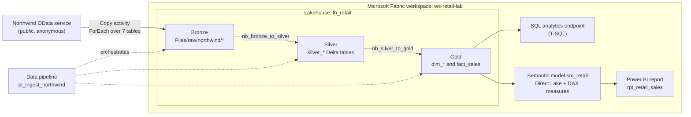
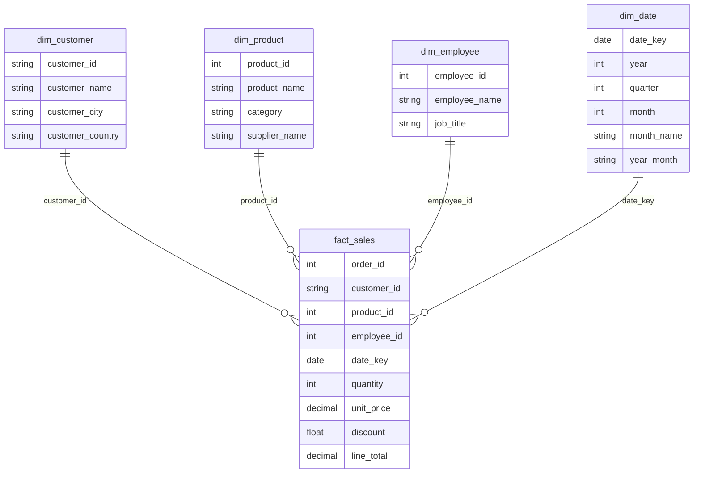

# Northwind Retail Analytics on Microsoft Fabric

An end-to-end data engineering project on **Microsoft Fabric**. It ingests the public Northwind OData service into a lakehouse, transforms it through a medallion architecture (bronze → silver → gold) with PySpark, models it as a star schema, and serves it through a **Direct Lake** semantic model and a Power BI report. Everything is orchestrated by a single Fabric data pipeline.

| Metric | Result |
|---|---|
| Orders | 830 |
| Order lines (`fact_sales` rows) | 2,155 |
| Total revenue | ~$1.27M |
| Average order value | ~$1.53K |
| Date range | Jul 1996 – May 1998 |

> Screenshots: add yours to a `docs/` folder and update the paths below.

---

## Architecture



### Star schema (gold layer)



---

## Tech stack

- **Microsoft Fabric**: Lakehouse, Data Pipeline, Notebooks (PySpark), SQL analytics endpoint, Semantic model (Direct Lake), Power BI
- **Storage format**: Delta Lake
- **Languages**: PySpark, T-SQL, DAX
- **Source**: [Northwind OData v4](https://services.odata.org/V4/Northwind/Northwind.svc/)

## Repository structure

```
.
├── notebooks/
│   ├── nb_bronze_to_silver.ipynb
│   └── nb_silver_to_gold.ipynb
├── docs/                      # screenshots (pipeline, model view, report)
└── README.md
```

---

## Build steps

### 1. Workspace and lakehouse
Created the workspace `ws-retail-lab` on a Fabric capacity (trial or F2), then a lakehouse `lh_retail`. The lakehouse automatically provides a **Files** area (bronze), a **Tables** area (Delta), a SQL analytics endpoint, and a default semantic model.

### 2. Ingestion pipeline (`pl_ingest_northwind`)
- Pipeline parameter `tables` (array): `Customers`, `Products`, `Employees`, `Orders`, `Order_Details`, `Categories`, `Suppliers`
- A **ForEach** (sequential, to be gentle on the public demo server) containing a **Copy data** activity named `Copy_table`
- Source: Northwind OData connection, with the table name driven by `@item()`
- Destination: `Files/raw/northwind/<table>/` in `lh_retail`
- Validated row counts after the run: Customers 91, Products 77, Employees 9, Orders 830, Order_Details 2,155, Categories 8, Suppliers 29

### 3. Bronze → Silver (`nb_bronze_to_silver`)
A single `load()` function reads each table from bronze, handling both file shapes (Parquet from the OData connector, or a JSON wrapper with a `value` array). It drops `@odata.*` metadata columns and binary image columns (`Photo`, `Picture`), removes duplicates, and writes each table as a Delta table named `silver_<table>`.

```python
df = load(t).dropDuplicates()
df.write.mode("overwrite").option("overwriteSchema", "true") \
  .format("delta").saveAsTable(f"silver_{t.lower()}")
```

### 4. Silver → Gold (`nb_silver_to_gold`)
Builds the star schema:
- `dim_customer`, `dim_employee`
- `dim_product` (product joined to category and supplier)
- `dim_date`, generated with `sequence()` across the order date range, with `year`, `quarter`, `month`, `month_name` and a sortable `year_month` (`yyyy-MM`)
- `fact_sales`: one row per order line, with `line_total = quantity * unit_price * (1 - discount)`

Sanity checks in the notebook: `fact_sales` has exactly 2,155 rows, zero null `date_key` values, and no products with a null category.

### 5. SQL analytics endpoint
Ad hoc T-SQL over the gold tables, for example:

```sql
SELECT TOP 10 c.customer_name, ROUND(SUM(f.line_total), 0) AS revenue
FROM fact_sales f
JOIN dim_customer c ON f.customer_id = c.customer_id
GROUP BY c.customer_name
ORDER BY revenue DESC;
```

### 6. Semantic model (`sm_retail`, Direct Lake)
- Added the five gold tables
- Created four many-to-one, single-direction, **active** relationships from `fact_sales` to each dimension
- DAX measures:

```
Total Revenue   = SUM(fact_sales[line_total])
Order Count     = DISTINCTCOUNT(fact_sales[order_id])
Avg Order Value = DIVIDE([Total Revenue], [Order Count])
```

### 7. Report (`rpt_retail_sales`)
Monthly revenue line chart (`dim_date[year_month]`), revenue by product category, revenue by customer country (map), KPI cards (revenue, order count, average order value), and slicers for year and employee.

### 8. Orchestration
`ForEach (Copy_table)` → `nb_bronze_to_silver` → `nb_silver_to_gold`, chained with success dependencies and monitored in the **Monitor hub**. The schedule is switched off after testing, since Northwind never changes.

---

## Problems solved

### OData pagination and completeness
**Problem:** OData services can split larger tables across pages, so a copy that follows only the first page silently loads a truncated table, with no error.
**Fix:** Verified every table's row count against the known Northwind totals after ingestion (for example Orders = 830 and Order_Details = 2,155) and again in the notebook before writing to silver. If a count comes up short, check the connector's pagination setting (for a REST source, an AbsoluteUrl pagination rule on `@odata.nextLink`).
**Takeaway:** Always reconcile row counts at the first landing zone.

### Schema mismatches
Two separate issues:

1. **Source shape and types.** Raw files differ by connector: Parquet with typed columns, or a JSON wrapper with a `value` array. Some columns are unwanted binary (`Photo`, `Picture`), and prices arrive as `decimal(38,18)`. The `load()` function detects the format, flattens the wrapper, and drops `@odata.*` and binary columns, and the schema is printed for every table as a check.
2. **Delta schema mismatch on write.** Adding `year_month` to `dim_date` made the pipeline fail with `A schema mismatch detected when writing to the Delta table`, because Delta rejects schema changes by default. Fixed with `.option("overwriteSchema", "true")` on the write. The first rerun still failed because **a pipeline runs the saved notebook, not the unsaved edits in the editor**, so the notebook had to be saved before rerunning.

**Takeaway:** Decide on a schema-evolution policy up front. `overwriteSchema` suits full rebuilds, while `mergeSchema` suits incremental additive loads.

### Inactive relationship in the semantic model
**Problem:** The line chart showed the same value (the full 1.27M) for every month, a `(Blank)` category appeared on the axis, and the year slicer had no effect. In Model view, the `dim_date` → `fact_sales` line was **dotted**, meaning the relationship was inactive, so the date dimension was not filtering the fact table.
**Fix:** Opened the relationship and set it to many-to-one, single direction, with **Make this relationship active** ticked. The measures then responded to the date filter and the chart varied by month.
**Takeaway:** A flat or constant measure across a dimension is a strong sign of a missing or inactive relationship. Check Model view first.

### Month ordering and a zigzag axis
**Problem:** `month_name` sorts alphabetically (Apr, Aug, Dec…), and putting `month_name` and `year` together on one axis made the line zigzag between years.
**Fix:** Added a single `year_month` column (`yyyy-MM`) in the gold notebook, which sorts correctly as text and removes the need for a sort-by-column setting.

### Direct Lake: the new column did not appear
**Problem:** After adding `year_month` to the Delta table, it was missing from the semantic model and the report.
**Cause:** Each layer reads from the one before it: Delta table → SQL analytics endpoint → semantic model → report. New columns are not added to a model automatically, and the endpoint's metadata can lag behind the lakehouse.
**Fix:**
1. Confirmed the column in the lakehouse table after a successful gold notebook run
2. Waited for the SQL endpoint to sync (checked with `SELECT TOP 5 year_month FROM dim_date`)
3. Used **Edit tables** in the semantic model and ticked the new column
4. Reopened the report so the Data pane refreshed

**Takeaway:** Direct Lake models do not support DAX calculated columns, so derived columns belong in the transformation layer (the notebook), not in the model.

### Partial final month
The last point on the revenue line drops sharply because the dataset ends in early May 1998, so that month holds only a few days of orders. This is a data characteristic, not a bug. It can be filtered out of the visual if desired.

---

## What I learned

- **Medallion architecture in practice.** Keeping bronze untouched and doing cleaning in silver and modelling in gold made every bug easy to localise, because I could inspect each layer separately.
- **Direct Lake behaviour.** Changes flow through several layers (Delta → SQL endpoint → semantic model → report), and each layer can lag or need an explicit refresh. Calculated columns are not supported there, so transformations belong in the notebook.
- **Pipelines run saved artifacts.** Unsaved notebook edits do not run. This cost me one failed pipeline run.
- **Validate early.** Row-count reconciliation and schema printing at each layer caught issues before they reached the report.
- **Star-schema discipline.** Most report problems (flat lines, blanks, wrong sorting) were modelling issues, not visual issues.
- **Delta schema evolution.** Delta rejects schema changes by default, and choosing between `overwriteSchema` and `mergeSchema` is a design decision.

## Possible next steps

- Add a **Warehouse** and load the gold tables with T-SQL to compare it with the lakehouse
- Add **row-level security** so each employee sees only their own sales
- Switch to incremental loads using a watermark, with `mergeSchema` for additive changes
- Add **Git integration** and deployment pipelines (dev → test → prod)
- Add data quality checks as a dedicated notebook step

## How to reproduce

1. Create a Fabric workspace on a trial or paid capacity.
2. Create a lakehouse named `lh_retail`.
3. Create the pipeline `pl_ingest_northwind` with the ForEach and Copy activity described above.
4. Import the two notebooks from `notebooks/`, attach `lh_retail` as the default lakehouse, and chain them after the ForEach.
5. Run the pipeline, then create the semantic model and report from the gold tables.

## Cost and cleanup

Pause the Fabric capacity when not working (if using paid F2), turn off pipeline schedules, stop notebook sessions, and delete the resource group when you are finished to stop billing.

## Data source

Northwind sample data from the public OData demo service at `services.odata.org`. The service is for demos and may change or be unavailable.
